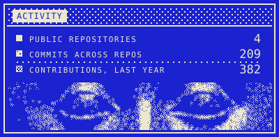
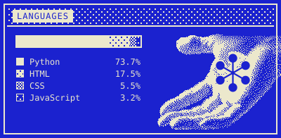

  

  

### Currently

-  **[Zen Browser Lite](https://github.com/m3lonxd/zen-browser-lite)** — unofficial low-memory setup of the official Zen Browser: 60% less RAM once background tabs go idle, measured on real sites. No fork, no rebuild.
-  **[Computer Use Linux](https://computeruselinux.vercel.app)** — lets an AI agent see and drive a real desktop and the terminals already open on it, with the same commands on Linux, Windows and macOS.
- **[NexGuard](https://nexguard.duckdns.org)** — local security panel for one Linux server: OPSEC audit, DDoS watch, live attack map, SSH honeypot.

### Projects

| Project | What it does | |
|---|---|---|
|  **[zen-browser-lite](https://github.com/m3lonxd/zen-browser-lite)** | Official Zen Browser with tuned memory defaults and a working tab unloader; one-line Linux installer | [site](https://zenbrowserlite.vercel.app) |
|  **[computer-use-linux](https://github.com/m3lonxd/computer-use-linux)** | Desktop and terminal control for AI agents — window UI trees, screenshots, clicks, typing | [site](https://computeruselinux.vercel.app) |
| **[nexguard](https://github.com/m3lonxd/nexguard)** | Local security panel for one Linux server — OPSEC audit, DDoS watch, live attack map, SSH honeypot | [site](https://nexguard.duckdns.org) |

### Stack

  

### Activity

  
  

Terminal and cards are generated every four hours by this repository's own workflow. Terminal font: JetBrains Mono (OFL). 
Zen logo by the Zen Browser team, <a href="https://creativecommons.org/licenses/by-nc-sa/4.0/">CC BY-NC-SA 4.0</a>, from <a href="https://github.com/zen-browser/branding-archive">zen-browser/branding-archive</a>.
