  

  

### Currently

- **NexBrowser** — a Zen/Firefox fork that idles at a fraction of the memory, with password-locked accounts and a Liquid Glass UI. Builds for Linux, Windows and macOS.
- **NexRemote** — lets an AI agent see and drive a real desktop and the terminals already open on it, with the same commands on Linux, Windows and macOS.

### Projects

| Project | What it does | |
|---|---|---|
| **[nexbrowser](https://github.com/m3lonxd/nexbrowser)** | Low-memory Zen/Firefox-based browser with encrypted accounts and a Liquid Glass UI | [site](https://nexbrowser.vercel.app) |
| **[nexremote](https://github.com/m3lonxd/nexremote)** | Desktop and terminal control for AI agents — window UI trees, screenshots, clicks, typing | |

### Stack

  

### Activity

  
  

Cards are generated daily by this repository's own workflow.
